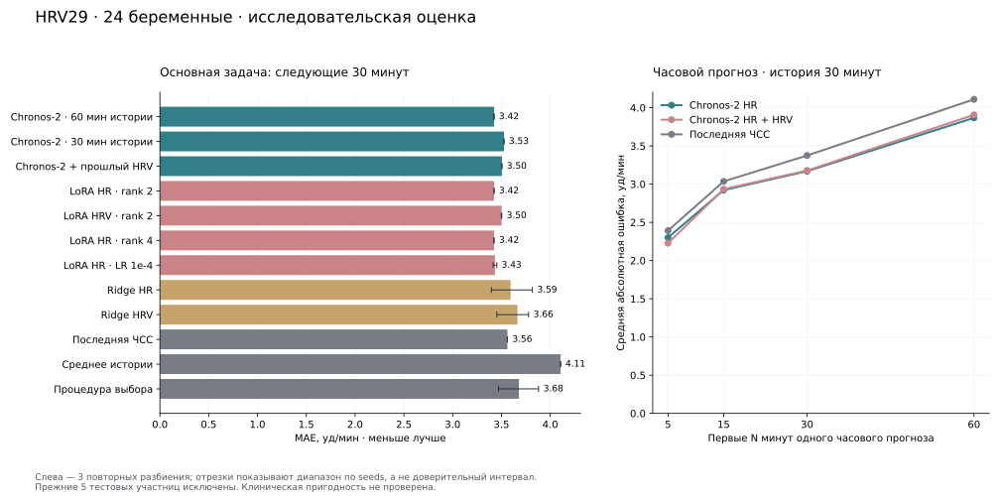

# Контекст, прошлый HRV и повторная проверка обучения

Команда `ablation` реализует следующий этап исследовательского плана на HRV29.
Данные медорганизации пока не используются. Это разработка на уже изученной
development-когорте; прежние пять test-участниц полностью исключены.
Источник — [открытый HRV29](https://zenodo.org/records/7102622), лабораторные
данные беременных. Это не выгрузка российской медицинской организации.

## Зафиксированный протокол

Основная задача — **12 прошлых точек → 6 будущих**, шаг 5 минут: час истории
для прогноза на 30 минут. Это дополнительный исследовательский профиль.
Цель продукта с прогнозом на час и профиль API с суточной историей сохраняются.
Часовая задача оценивается отдельно; результаты разных горизонтов не выдаются
за рост точности одной и той же задачи.

В основной когорте 24 женщины. Для каждого из seeds 20261104, 20261105,
20261106 строятся три внешние группы: 12 женщин train, 4 внутренняя validation,
8 assessment. В пределах одного разбиения женщины не пересекаются. Каждая
оценивается снаружи ровно один раз на seed. Три повтора не создают 72 новых
женщины. Обучение каждого адаптера начинается от исходной закреплённой модели.

| Вариант | История | Признаки | Настройка |
|---|---:|---|---|
| Исходная Chronos-2, основная база | 60 мин | ЧСС | Без адаптации |
| Короткая история | 30 мин | ЧСС | Без адаптации |
| Дополнительные прошлые признаки | 60 мин | ЧСС, RMSSD, SDNN | Без адаптации |
| Ridge по лагам | 60 мин | ЧСС | alpha 1 / 10 / 100 по внутренней validation |
| Ridge с HRV | 60 мин | ЧСС, RMSSD, SDNN | Та же процедура |
| LoRA HR rank 2 | 60 мин | ЧСС | LR 1e-5 |
| LoRA HRV rank 2 | 60 мин | ЧСС, RMSSD, SDNN | LR 1e-5 |
| LoRA HR rank 4 | 60 мин | ЧСС | LR 1e-5 |
| LoRA HR rank 2, другой LR | 60 мин | ЧСС | LR 1e-4 |
| Простые прогнозы | Доступная история | ЧСС | Последнее значение, среднее |

LoRA: alpha = 2 × rank, 100 шагов, проверка forecast MAE каждые 10 шагов,
4 выборки записей женщин в обучающем batch. Sampler выбирает с возвращением:
одна женщина может встретиться в batch повторно. В нативной библиотеке batch измеряется числом
рядов: для HR это 4, для HR+двух HRV — 12. Так число выборок записей женщин
на шаг остаётся одинаковым. Всего 36 обучений: 4 варианта × 3 внешних группы × 3 seeds.
Численные значения нативного training loss между HR/HRV не сравниваются:
маскированные каналы и усреднение меняют его масштаб. Выбор checkpoint
использует forecast MAE целевой ЧСС в уд/мин с равным весом женщин.

В каждом разбиении процедура выбора сравнивает заранее объявленные варианты
по MAE с равным весом женщин. Для смены основной базы нужны минимум 1%
снижения MAE и улучшение хотя бы половины внутренней validation. Это
инженерный фильтр, не медицинский критерий и не проверка значимости.
Решение записывается до прогнозов обученных вариантов для внешней группы.
Все фиксированные кандидаты затем оцениваются для аудита; внешние ошибки
не меняют список настроек в текущем запуске.

## Данные и защита от утечек

- Исходный Excel проверяется по закреплённому SHA-256; для covariates
  используется только `merged_visit1`, с точным совпадением женщины,
  относительного окна и ЧСС. Обычные и стрессовые записи не склеиваются.
- Участницы берутся из исходных train/validation разбиений HRV29. Их состав
  не пересчитывается после добавления HRV. Прежняя test-группа исключена.
  Команда проверяет исходные 29 женщин и split с seed 42: повторная подготовка
  с другим seed не позволяет переопределить уже просмотренную test-группу.
- Последние шесть HR-точек каждой записи служат общими целями для всех
  основных вариантов. Смена контекста не меняет целевую группу и origin.
- В Chronos передаются только прошлые HRV. Будущие HRV и HR остаются целями/
  скрытыми данными; кортизол и метка stress не используются.
- Невалидные HRV превращаются в пропуски без удаления соответствующей HR-цели.
  Chronos получает пропуски нативно; Ridge обучает заполнение только на train.
- Ridge прогнозирует изменения от последней известной ЧСС. Признаки:
  центрированные прошлые HR, последнее HR и, для HRV-версии, log1p прошлых
  RMSSD/SDNN. `SimpleImputer → StandardScaler → Ridge` обучаются внутри
  каждого разбиения; scaler и регрессия используют равный суммарный вес женщин.
- Для Ridge сохраняются модели joblib. Загружать такие файлы следует только
  из доверенного запуска с совместимыми версиями зависимостей.

Отдельные заранее заданные сравнения:

1. Контекст 6 / 12 / 16 при горизонте 6 — только на общем поднаборе женщин,
   у которых хватает 22 реальных точек. Состав поднабора записывается числом
   женщин; он отличается от основной когорты из 24.
2. Часовой прогноз: контекст 6, горизонт 12, фиксированное начало цели.
   Сравниваются базовая Chronos с HR/HRV и простые прогнозы. Ошибки первых
   5 / 15 / 30 / 60 минут считаются из одного и того же часового прогноза;
   это оценка по горизонтам, а не четыре отдельных переобученных модели.

## Метрики и ограничения

Сохраняются MAE, RMSE, средняя по женщинам MAE и ошибки по шагам. Для
квантильных прогнозов — покрытие p10–p90, ширина, pinball loss и interval
score для номинального покрытия 80%. Ridge и простым точечным прогнозам
интервалы не придумываются.

Парные различия усредняются по шагам и повторным seeds внутри женщины;
bootstrap пересэмплирует женщин, не отдельные точки. 95%-е интервалы условны
на уже обученных моделях: обучение внутри bootstrap не повторяется. Ошибки
по seeds показывают чувствительность к разбиению и обучению, но не заменяют
внешнюю когорту. Множественные сравнения исследовательские; автоматического
выбора модели API по ним нет.

Калибровка интервалов в этом запуске диагностируется метриками. Отдельный
калибратор, обученный на тех же четырёх женщинах, что используются для выбора,
не заявляется независимо проверенным. Медицинские исходы здесь не изучаются.

## Запуск

Нужен Python 3.11+; рекомендуем Python 3.12. Для CPU сначала установите
совместимую CPU-сборку PyTorch согласно [первому этапу](finetuning.md).

```powershell
.\.venv\Scripts\python.exe -m pip install -e ".[study,test]"
.\.venv\Scripts\python.exe -m pregnancy_monitor prepare-hrv29 --output-dir data/hrv29
.\.venv\Scripts\python.exe -m pregnancy_monitor ablation --dataset data/hrv29 --workbook data/raw/maternal_ECG_cortisol_data_FINAL.xlsx --output-dir outputs/hrv29_ablation_v3 --steps 100 --cpu-threads 4
.\.venv\Scripts\python.exe -m unittest discover -s tests -v
```

Linux/macOS: заменить путь к Python на `.venv/bin/python`. `--offline`
использует заранее закешированную базовую модель. Каталог результата должен
быть новым или пустым. `--seeds` позволяет явно задать набор повторов;
сопоставляйте результаты только с фактически выполненным планом.
При `--offline` включается также `HF_HUB_OFFLINE`, чтобы сохранение PEFT
не выполняло дополнительные проверки Hub. Сначала модель нужно загрузить
с разрешённым сетевым доступом. Веса и числовая постановка от режима не меняются.

В каталоге запуска: `study_plan.json` до обучения, сводный `report.json`,
`progress.json`, решения `selection.json` по группам, adapters/checkpoints,
модели Ridge и индивидуальные прогнозы. В Git входят код, протокол и агрегаты;
веса и индивидуальные прогнозы исключены.

## Источники методики

- [Chronos-2 quickstart, v2.3.2](https://github.com/amazon-science/chronos-forecasting/blob/v2.3.2/notebooks/chronos-2-quickstart.ipynb)
  и нативный `Chronos2Pipeline.fit`: past-only covariates, LoRA, validation.
- [Scikit-learn: предотвращение утечки](https://scikit-learn.org/stable/common_pitfalls.html),
  [Ridge](https://scikit-learn.org/stable/modules/generated/sklearn.linear_model.Ridge.html)
  и групповые разбиения. Версия study-зависимости закреплена: 1.9.1.
- Изучено процедурное руководство K-Dense по scikit-learn и его раздел
  model evaluation; применены принципы Pipeline внутри train, группировки
  по пациенткам и отдельного внутреннего выбора. Проверенный blob руководства:
  `9e26cff8bd282c523b645719c817c1415e0ddb3f`.
- Kassis T., Agarwal V., He Y., Patel D., Brueckner A. M. (2026).
  *Scientific Agent Skills: A Library of Procedural Knowledge for Research Agents*.
  arXiv:2609.00065, актуальная проверенная версия v2 от 02.09.2026;
  [DOI](https://doi.org/10.48550/arXiv.2609.00065).
  Это источник организации ML-процедуры; точность модели данным источником
  не подтверждается. Общие примеры случайного разбиения строк для пациентских
  временных рядов не использованы.

## Фактический результат

Завершены **36 LoRA-обучений по 100 шагов** и 18 процедур подбора Ridge
(54 обучения по трём alpha). Основная когорта — **24 женщины**, 144 уникальные будущие точки
на метод в каждом повторе. 432 оценки на метод включают три повтора тех же
целей, а не новых пациенток. Исходная модель и профиль API не изменены.

| Метод | MAE, уд/мин | Диапазон MAE по seeds | RMSE | Покрытие p10–p90 |
|---|---:|---:|---:|---:|
| Chronos-2, история 60 мин | 3,4245 | 3,4245–3,4245 | 4,4485 | 86,11% |
| Chronos-2, история 30 мин | 3,5259 | 3,5259–3,5259 | 4,5541 | 88,19% |
| Chronos-2 + прошлый HRV | 3,5045 | 3,5045–3,5045 | 4,5219 | 84,03% |
| LoRA HR, rank 2, LR 1e-5 | 3,4241 | 3,4234–3,4247 | 4,4460 | 86,11% |
| LoRA HRV, rank 2, LR 1e-5 | 3,5013 | 3,4987–3,5031 | 4,5166 | 84,03% |
| LoRA HR, rank 4, LR 1e-5 | 3,4239 | 3,4214–3,4253 | 4,4437 | 86,34% |
| LoRA HR, rank 2, LR 1e-4 | 3,4331 | 3,4142–3,4517 | 4,4374 | 85,19% |
| Ridge HR | 3,5938 | 3,3965–3,8164 | 4,7039 | — |
| Ridge HRV | 3,6640 | 3,4531–3,7778 | 4,7437 | — |
| Последнее значение | 3,5611 | 3,5611–3,5611 | 4,9060 | — |
| Среднее истории | 4,1058 | 4,1058–4,1058 | 5,0213 | — |
| Процедура внутреннего выбора | 3,6788 | 3,4705–3,8799 | 4,7015 | — |

На этой когорте увеличение истории с 30 до 60 минут снизило MAE на 2,88%.
Условный 95%-й bootstrap-интервал разницы «короткая история минус длинная»:
[-0,1640; 0,4434] уд/мин. Это сравнение одинаковых женщин и целей;
интервал включает ноль и не подтверждает устойчивое улучшение.

Минимальная MAE среди LoRA получена у rank 4, но разница с исходной моделью
составляет только −0,0006 уд/мин; условный 95%-й интервал [−0,0095; 0,0088].
Практически заметный прирост от дообучения не показан. Добавление HRV
увеличило среднюю MAE в основной и часовой задачах. Процедура внутреннего
выбора дала 3,6788 против 3,4245 у фиксированной базы: выбор по четырём
женщинам оказался неустойчивым. Изменять модель API на основании этих
результатов оснований нет.

Исходные модели без адаптации не зависят от разбиения, поэтому повторные seeds
дают им одинаковые прогнозы. Диапазон по seeds для обученных моделей —
описание устойчивости, не доверительный интервал.

Выбор на внутренней validation по внешним группам:
Chronos-2, история 60 мин — 4; Chronos-2, история 30 мин — 1; Последнее значение — 2; Ridge HR — 1; Среднее истории — 1.

Результат процедуры выбора приведён отдельно от результатов кандидатов.
Минимальная ошибка отдельного кандидата в сводной таблице не используется
как независимое подтверждение его превосходства и не переключает API.

### Одинаковый поднабор для контекста 16

Поднабор: 16 женщин; у всех хватает реальных точек для каждого контекста.
Ниже оценивается следующий один и тот же 30-минутный блок.

| Контекст | MAE, уд/мин |
|---|---:|
| 30 мин | 3,9099 |
| 60 мин | 3,9170 |
| 80 мин | 4,0443 |

Числа этого поднабора не сопоставляются напрямую с полной когортой из 24 женщин.
На общем поднаборе дальнейшее удлинение истории не снизило MAE.

### Отдельный прогноз на час

24 те же женщины, история 30 минут, горизонт 60 минут. Адаптеры, обученные
на 30-минутную цель, здесь не оцениваются; сравниваются фиксированные исходные модели.

| Метод | MAE, уд/мин | RMSE |
|---|---:|---:|
| Исходная Chronos-2 HR | 3,8679 | 5,0593 |
| Chronos-2 + прошлый HRV | 3,9074 | 5,1818 |
| Последнее значение | 4,1097 | 5,8538 |
| Среднее истории | 4,3028 | 5,4652 |

У исходной Chronos-2 фактическое покрытие часового p10–p90 составило 96,53%
при номинальных 80%; средняя ширина — 24,77 уд/мин. Это широкие интервалы,
а не свидетельство клинической надёжности. Независимая проверка калибровки
остаётся отдельной задачей.



### Проверки и воспроизводимость

- 57 программных тестов прошли, включая инвариантность прогноза к подмене
  скрытых будущих HR/HRV, изоляцию прежней test-группы, одинаковые цели
  разных контекстов и обучение preprocessing только на train.
- В аудите всех 36 обучений подтверждены 100 шагов, изменение адаптера и
  выбор checkpoint с минимальной внутренней forecast MAE.
- HRV-адаптер загружен заново: максимальное расхождение квантилей 7.6293945e-06 уд/мин.
- Все 36 адаптеров повторно загружались для внешней оценки; исходная база
  не изменилась. Прежние пять тестовых женщин не оценивались.
- Полный офлайн-запуск на CPU, 4 потока, float32: 2584,57 с
  (43,08 мин). Это замер конкретной машины и набора.

Полный отчёт: [results/hrv29_ablation_v3.json](results/hrv29_ablation_v3.json).
Клиническая пригодность не оценивалась. Для окончательного подтверждения
нового решения необходимы новые подходящие данные и непросмотренная когорта.
